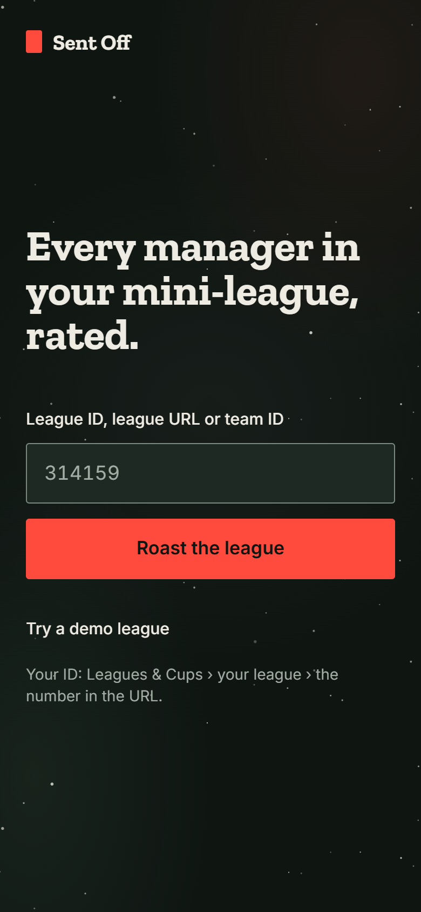
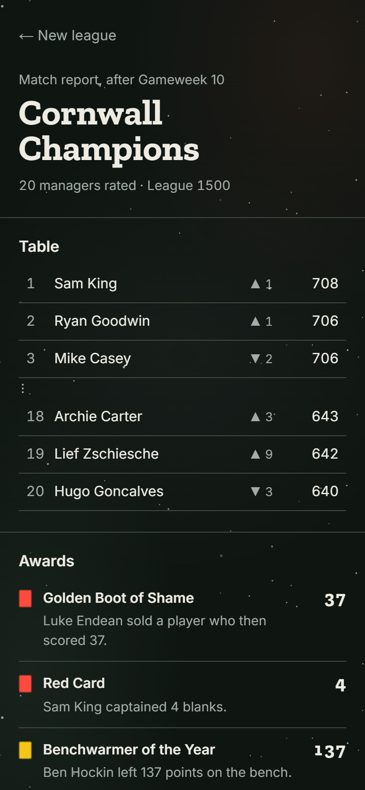

# Sent Off

Every manager in your Fantasy Premier League mini-league, rated out of 10 and roasted with their own numbers.

**Live:** [sentoff.lol](https://www.sentoff.lol). Paste a league ID, a league URL or your team ID, and get a match report for the group chat: a rating, a red or yellow card and a roast for every manager, each one built from public FPL data. Free, no login, nothing to install.


A mini-league lives in its group chat, and the chat runs on regret: points left on the bench, the captain who blanked, the player sold the week before he hauled. All of that is public in the FPL API. The tools that turn it into banter are paid, per-league subscriptions. Sent Off is the free, one-shot version, built over a weekend (15 to 16 November 2026).

## How it works

1. **You paste an ID.** A league ID, a pasted FPL URL or a team ID. Only the number is kept; no URL is ever built from your text. A team ID shows the leagues that team is in, so you can pick one.
2. **Sent Off reads the league.** One standings request, then every manager's history, transfers and picks, four requests at a time with retries on rate limits. The first standings page only, so a league is capped at 20 managers and the global league can't be used to hammer FPL.
3. **Eleven rules score each manager.** Pure functions over the data, one file each, with a one-line definition beside it. Each returns a fact with a *sting* from 0 to 100. Whoever is worst in the league for a fact gets extra sting, the runner-up a little. The top fact gives the manager their title (The Bench Warmer, The Captaincy Criminal, and so on) and their rating: `round((100 - sting) / 10)` out of 10. Sting of 75 or more is a red card, 35 or more a yellow.
4. **A model writes the joke.** The top three facts go to Groq's `openai/gpt-oss-120b` (or Claude Haiku 5.5 if only an Anthropic key is set) as JSON, with the manager and team names in a marked block the model is told is not an instruction. It writes 25 to 40 words and ends on the sharpest number, with the shape of the closer varied (a deadpan comparison, a fake compliment, a one-word verdict) so a league of twenty doesn't read like one joke. Every number in the reply must appear in the facts it was given; a reply that fails that, the word count, a banned-word list or a no-links check is thrown away and a template line built from the same fact takes its place.
5. **The report is cached.** Until the next deadline once the gameweek is over, or for an hour while it's still being played, in Upstash Redis. A league costs one build per gameweek; everyone after that gets it in one go.

The home page's two sample cards are static. Everything on a league page is computed.

### The rules

| Rule | What it measures | Title it gives |
|---|---|---|
| `bench_burner` | Points left on the bench all season (after auto-subs) | The Bench Warmer |
| `loyalty_card` | Longest run of gameweeks with the same captain | The Loyalist |
| `hit_man` | Points paid in hits, and the worst one (what the incoming player scored that week) | The Minus Four Merchant |
| `the_curse` | The most a sold player scored in the three gameweeks from the sale | The Panic Seller |
| `red_arrows` | Longest run of consecutive gameweeks with a worse overall rank | The Freefaller |
| `cucumber` | Gameweeks where this manager had the lowest score in the league | The Cucumber |
| `sheep_index` | Share of the squad owned by more than 30% of all FPL managers | The Sheep |
| `chip_panic` | Wildcard before GW4, bench boost or triple captain returning under 10 | The Chip Burner |
| `dead_wood` | Players started in five or more gameweeks averaging a point or less | The Hoarder |
| `cap_blank` | Gameweeks where the captain scored 2 or less before the multiplier | The Captaincy Criminal |
| `serial_chaser` | Transfers in of the previous gameweek's top scorer | The Serial Chaser |

Four awards sit above the cards: **Golden Boot of Shame** (worst `the_curse`), **Red Card** (worst `cap_blank`), **Benchwarmer of the Year** (worst `bench_burner`) and the **Wooden Spoon** (last place). The leader keeps a "Man of the match" label while their own worst fact stays mild; once it bites, they're sent off like everyone else.

### Pages and routes

| Route | What it does |
|---|---|
| `/` | The one input, a demo league link and where to find your ID |
| `/league/[id]` | The match report. A cached league renders on the server in one go; a cold one renders the shell and streams the build from the API route in three phases: the table, a "Reading 14 of 20" counter, then cards as each roast lands |
| `/team/[id]` | The leagues a team is in (up to 20), to pick one |
| `/api/league/[id]` | Builds a report and streams progress. The only route that calls FPL |
| `/api/card/[id]/[entry]` | A manager's share image: 1080×1350, one name, one number, one line, the league link. Read-only: a generic branded image if the league isn't cached |
| `/league/[id]/opengraph-image` | The 1200×630 link preview, read-only in the same way |

Cards can't be streamed one by one: sting is ranked across the league, so nothing is final until every manager is read. That's why the stream has three phases rather than a card per manager.

<p>
  
  
</p>

## Run it

You need Node.js 20 or later.

```sh
npm install
npm run dev
```

Open http://localhost:3000 and try the demo league. With no environment variables set, every roast is a template line and the cache is an in-memory map, so nothing else needs installing. To get model-written roasts and a shared cache, copy `.env.example` to `.env.local` and fill in what you have:

| Variable | What it enables |
|---|---|
| `GROQ_API_KEY` | Model-written roasts through Groq's free tier. `GROQ_MODEL` overrides the default model |
| `ANTHROPIC_API_KEY` | Model-written roasts through Claude Haiku 5.5, used when there's no Groq key |
| `UPSTASH_REDIS_REST_URL`, `UPSTASH_REDIS_REST_TOKEN` | A shared cache across server instances. On Vercel the Upstash integration's `KV_REST_API_URL` and `KV_REST_API_TOKEN` work too |
| `NEXT_PUBLIC_SITE_URL` | The public origin for share links and the line on share images. Not in `.env.example`; only needed in production, and falls back to the Vercel deployment URL |

| Command | What it does |
|---|---|
| `npm run dev` | Dev server |
| `npm run build` | Production build |
| `npm start` | Serve the production build |
| `npm run lint` | ESLint |
| `npm test` | Vitest: 91 tests, none of them touching the network |

## Keeping it safe and up

The app shows nothing FPL doesn't already show, but a site that roasts real names from a public API needs some guard rails:

- **The model only ever gets numbers.** It never sees raw FPL data, and it can't put a number in a roast that wasn't in the facts. PG-13 is a rule in the prompt and a banned-word check on the output.
- **Report a roast.** Every card has a link that opens a prefilled GitHub issue. A manager who asks is added to a blocklist and their card renders as "opted out" from then on.
- **Rate limits, so Sent Off never looks like a scraper to FPL.** A cold build counts against a per-IP window (5 in 10 minutes, keyed by a hash of the address, never the address itself) and a global cap (60 an hour). Cached reports never count. Past 2,000 model calls in a day, roasts fall back to templates and the app stays up.
- **Never cache a failure.** A league FPL says doesn't exist is remembered for a minute so a typo can't cost a 404 per reload. A failed build caches nothing.
- **Hostile input.** IDs are parsed as positive whole numbers with an upper bound. Manager and team names are capped at 40 characters, stripped of control characters, and hard-truncated on share images so an emoji-heavy name can't break the layout.
- **Server side only.** API keys and Redis credentials are never exposed to the client, and the writer, FPL client and store are never imported from a client component. Standard security headers on every response; no `dangerouslySetInnerHTML`.
- **Fresh cache per deploy.** Report keys carry the commit SHA, so a new prompt or rule is never served alongside roasts written by older code.

## Decisions

- **Facts in code, jokes from the model.** The rules are deterministic and tested against a snapshot of one real league (league 1500, Cornwall Champions, gameweek 10, captured 15 November 2026). The model only writes the joke, from three facts. That keeps roasts true and the cost to one short call per manager.
- **Usable with no keys.** Templates and the in-memory store mean tests and local dev need nothing installed, and the app degrades to template lines rather than going down when a key or cap fails.
- **Groq first, Claude second.** Groq's free tier serves a 120B open model that writes noticeably sharper lines than the templates at no cost. Claude Haiku 5.5 is the paid fallback.
- **Dark only.** One theme, and the share image is hard-coded dark, so every card pasted into a chat looks the same.
- **No database.** A report is a JSON blob with a three-day expiry. Redis is enough; the fallback is a map.

## Layout

```
app/
  page.tsx                          Home
  league/[id]/page.tsx              Match report (server render from cache, else client stream)
  league/[id]/opengraph-image.tsx   Link preview
  team/[id]/page.tsx                Pick a league from a team ID
  api/league/[id]/route.ts          Builds the report and streams progress
  api/card/[id]/[entry]/route.tsx   Share image for one card
components/                         Cards, awards, table, loading, share images, card rules
lib/
  report.ts                         The pipeline, in order
  fpl.ts                            FPL client: limiter, retry, slim payloads, ID parsing
  facts/                            One rule per file; index.ts runs them all and ranks sting
  writer.ts                         Groq or Claude, plus the output checks
  templates.ts                      Fallback lines, one per rule
  redis.ts                          Cache, counters, locks, blocklist; in-memory fallback
  types/                            Report, facts, slimmed FPL payloads
test/
  fixtures/league.json              One real league, captured once
  *.test.ts                         Rules snapshot, FPL client, pipeline, writer checks
docs/screenshots/                   The images in this README
```

## Stack

Next.js 16 (App Router, Cache Components), React 19, TypeScript, Tailwind CSS 4, Vitest, the Anthropic SDK, Groq's chat API, Upstash Redis. Deployed on Vercel.

## Not in v1

Login, leagues past 20 managers, head-to-head leagues, history across gameweeks, a spice-level selector, sending to WhatsApp directly.

## Licence

Zilla Slab, used on the share images, is under the SIL Open Font License (`assets/ZillaSlab-OFL.txt`). FPL data belongs to the Premier League; Sent Off reads the public API and stores nothing beyond a cached report.
